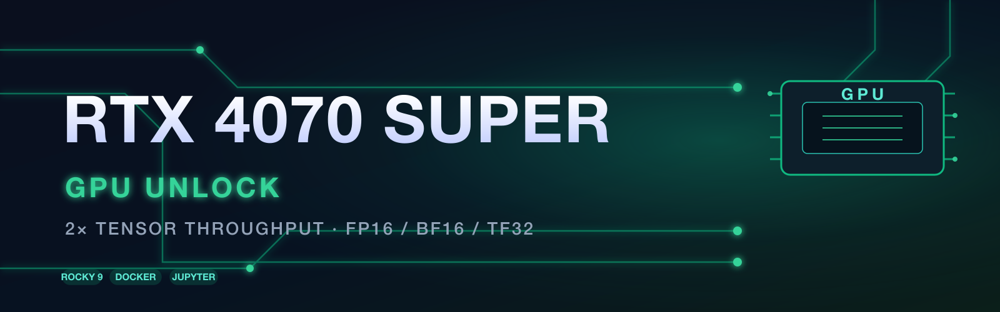
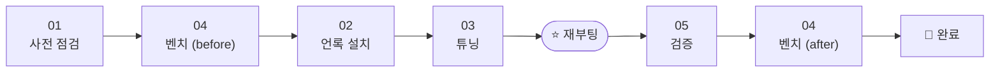

<p align="center">
  
</p>

<p align="center">
  
  
  
  
  
</p>

<p align="center">
  <b>NVIDIA가 반속으로 잠가둔 4070 SUPER 텐서코어를 소프트웨어로 해제하는 배포 키트</b><br>
  <a href="https://github.com/Zagitta/gpu-unlock">Zagitta/gpu-unlock</a> 기반 · Rocky Linux 9 · 도커 컨테이너 전체 자동 적용
</p>

---

## 🚀 무엇을 하는 키트인가요?

NVIDIA는 GeForce 카드의 **FP16 / BF16 / TF32 텐서 연산을 의도적으로 반속**으로 잠가둡니다.
이 키트는 [gpu-unlock](https://github.com/Zagitta/gpu-unlock) 을 주피터 노트북 서버(Rocky 9)에 안전하게 적용합니다.

> **핵심 포인트** — 언록은 GPU 칩 레지스터 단위로 걸리므로, 호스트는 물론 **모든 도커 컨테이너의 PyTorch 워크로드에 자동 적용**됩니다.
> GPU 하드웨어에는 아무 흔적이 남지 않으며, 롤백 스크립트로 언제든 원복 가능합니다.

| 워크로드 | 기대 효과 |
|---|---|
| ⚡ FP16/BF16 GEMM (FP32 축적) | **~2배** (~70 → ~130–145 TFLOPS) |
| 🧠 LLM 프리필 / 프롬프트 처리 | +25~55% |
| 🖼️ 이미지 생성 (FP16/BF16) | +30~55% |
| 🪙 양자화 모델 (INT8/INT4/GGUF) | 거의 없음 |
| 🎮 게임 · FP32 CUDA | 변화 없음 |

## 📦 저장소 구조

```
.
├── config.sh                  # ⚙️ 설정 파일 (이것만 수정)
├── README.md
└── scripts/
    ├── 01_preflight.sh        # 사전 점검 (+ --fix 로 패키지 자동 설치)
    ├── 02_install_unlock.sh   # 빌드·설치 + 부트 옵션 등록
    ├── 03_tune.sh             # 전력 상향·클럭 고정·드라이버 옵션
    ├── 04_benchmark.sh        # FP16/BF16 처리량 전/후 측정 (도커)
    ├── bench.py               # 벤치마크 코드 (잠긴 경로 정밀 측정)
    ├── 05_verify.sh           # 언록 적용 확인
    └── 06_rollback.sh         # 원상복구
```

## 🔁 배포 흐름



## 🛠️ 사전 조건

| 항목 | 상태 |
|---|---|
| NVIDIA 드라이버 + `nvidia-smi` | 주피터 서버라면 이미 설치돼 있음 |
| Docker + nvidia-container-toolkit | 벤치마크용 (`--gpus all`) |
| Secure Boot | 🔴 **꺼져 있어야 함** (BIOS) |
| 네트워크 | `github.com` · `download.nvidia.com` 접근 가능 |
| 콘솔 접근 | 첫 재부팅 시 원격 콘솔(IPMI 등) 접근 가능 권장 |

## 🚀 빠른 시작

```bash
# 서버에서 (private 저장소 — 최초 클론 시 GitHub 로그인/PAT 필요)
git clone https://github.com/SERU247153/4070super-unlock-deploy.git /opt/gpu-unlock-deploy
cd /opt/gpu-unlock-deploy
```

| # | 명령 | 시점 |
|---|---|---|
| 1️⃣ | `sudo bash scripts/01_preflight.sh --fix` | 재부팅 전 |
| 2️⃣ | `sudo bash scripts/04_benchmark.sh before` | 재부팅 전 |
| 3️⃣ | `sudo bash scripts/02_install_unlock.sh` | 재부팅 전 |
| 4️⃣ | `sudo bash scripts/03_tune.sh` | 재부팅 전 |
| 5️⃣ | `sudo reboot` | ⭐ **언록 적용** |
| 6️⃣ | `sudo bash scripts/05_verify.sh` | 재부팅 후 |
| 7️⃣ | `sudo bash scripts/04_benchmark.sh after` | 재부팅 후 |

> 3️⃣→4️⃣→5️⃣ 를 이어서 실행하면 **재부팅 1회**로 언록 + 드라이버 옵션이 함께 적용됩니다.

## ⚙️ 설정 (`config.sh`)

| 변수 | 기본값 | 설명 |
|---|---|---|
| `GPU_UNLOCK_TARGETS` | `all` | `all` 또는 특정 카드 (`0000:01:00.0`) |
| `POWER_LIMIT_MODE` | `max` | VBIOS 허용 최대 전력 상향 / 특정 W 값 |
| `CLOCK_LOCK` | `off` | `"2100,2730"` 형식으로 클럭 범위 고정 |
| `ENABLE_STREAM_MEM_OPS` | `1` | `NVreg_EnableStreamMemOPs=1` 등록 |
| `BENCH_MATRIX_SIZE` | `8192` | VRAM 부족 시 `6144` 로 낮춤 |

## ⚠️ 주의사항

- **첫 재부팅**은 반드시 콘솔 접근 가능한 상태에서 — 원격 서버는 보수적으로 진행
- **Secure Boot** ON 상태면 미서명 DKMS 모듈이 조용히 무시됨 (01 스크립트가 걸러냄)
- 전원 차단/재부팅 시 언록은 리셋되지만 **부팅 때 자동 재적용**
- 최대절전(hibernation)은 미지원 (서버라면 무관)
- NVIDIA 드라이버 업데이트에도 언록 유지 · 커널 업데이트 시 DKMS 자동 재빌드
- Rocky 9는 `dkms` 가 **EPEL** 저장소에 있음 (01 스크립트가 자동 설치)

## ↩️ 롤백

```bash
sudo bash scripts/06_rollback.sh   # 확인 질문에 yes
sudo reboot
```

부트 옵션 제거 → 패키지 제거 → 전력/클럭 기본값 복원 → 드라이버 옵션 제거까지 한 번에 수행합니다.

## 🔗 참고

- [Zagitta/gpu-unlock](https://github.com/Zagitta/gpu-unlock) — 원본 프로젝트 (⭐ 13.9k)
- RTX 40 세대(Ada)는 **Experimental** 단계 — 본 키트의 04/05 스크립트로 적용 여부를 즉시 확인 가능
